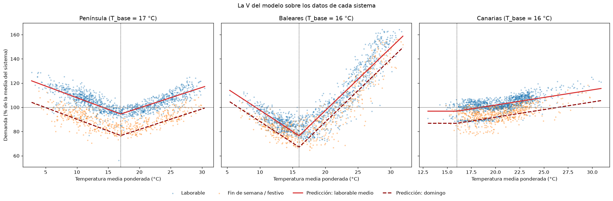
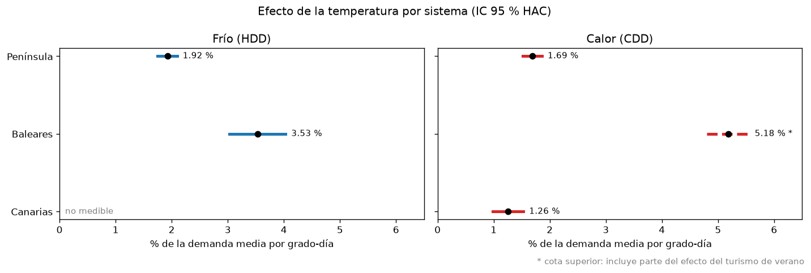
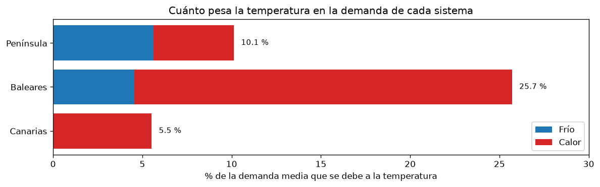
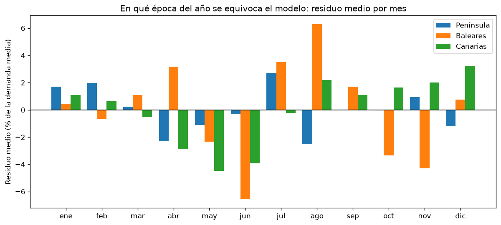

# Demanda eléctrica y temperatura en España

¿Cuánto sube la demanda eléctrica por cada grado de frío o de calor, y en qué se diferencian la Península, Baleares y Canarias?

Datos: Demanda diaria de Red Eléctrica y temperatura de Open-Meteo, 2021–2025.

Una regresión por sistema con grados-día de frío y de calor, controles de calendario y errores robustos a la autocorrelación.



## Resultado

Aumento de la demanda diaria por cada grado-día y peso de la temperatura, en % de la demanda media del sistema:

| Sistema | Frío (HDD) | Calor (CDD) | Peso de la temperatura |
|---|---|---|---|
| Península | 1,92 % (1,75 – 2,10) | 1,69 % (1,51 – 1,86) | 10 % |
| Baleares | 3,53 % (3,03 – 4,03) | 5,18 % (4,80 – 5,56)\* | 26 % |
| Canarias | no medible | 1,26 % (0,98 – 1,53) | 5,5 % |

Entre paréntesis, el intervalo de confianza al 95 % con errores HAC. 

Se observa un efecto significativo del aumento de la demanda energética relacionado con la Temperatura.

El **peso de la temperatura** es la parte de la demanda media que se debe al frío y al calor: el efecto por grado-día multiplicado por los grados-día medios de cada sistema.

La tabla completa está en [`results/efectos_temperatura.csv`](results/efectos_temperatura.csv).

\* Cota superior: en Baleares el turismo llega a la vez que el calor y el modelo no lo puede separar.



- **Baleares** es el sistema más sensible: casi el doble que la Península con el frío y el triple con el calor, aunque esta última cifra está inflada por el turismo. La temperatura explica una cuarta parte de su demanda.
- **Península**: reacciona algo más al frío que al calor (1,92 % frente a 1,69 %), y la temperatura explica en torno al 10 % de la demanda.
- **Canarias** es donde la temperatura pesa menos (5,5 %) y el frío no se puede medir: solo 42 días por debajo de 16 °C en cinco años.

Una explicación posible, aunque sin datos por sectores para comprobarla: en la Península hay mucha demanda industrial que no depende de la temperatura, en las islas pesa más el consumo de hogares, hoteles y comercios, y Canarias tiene un clima tan estable que la temperatura casi nunca se aleja del confort.



## Datos

| Dato | Fuente | Detalle |
|---|---|---|
| Demanda diaria (MWh) | [REData](https://www.ree.es/es/apidatos), Red Eléctrica | Por sistema eléctrico. API pública, sin token  |
| Temperatura media diaria (°C) | [Open-Meteo](https://open-meteo.com/en/docs/historical-weather-api), reanálisis ERA5 | Capital de cada provincia |
| Población provincial | [INE](https://www.ine.es/), padrón a 1 de enero de 2023 | Para ponderar la temperatura |

Ninguna fuente da una temperatura "de la Península" o "de Canarias", así que la construyo. Empecé con 6–10 ciudades grandes que cubrieran los distintos climas, pero dejaba fuera media España y el peso de cada ciudad era arbitrario.

Al final uso **la capital de cada provincia** (47 en la Península, Palma, Ibiza y Mahón en Baleares, y las dos capitales canarias), ponderada por la población de su provincia: un grado más en Madrid pesa más que uno en Soria porque ahí hay más gente consumiendo.

## Modelo

```
demanda_t = β0 + β_h·HDD_t + β_c·CDD_t + día de la semana + festivo + año + ε_t
```

- **HDD = max(T_base − T, 0)** y **CDD = max(T − T_base, 0)**: grados de frío y de calor respecto a una temperatura base. El modelo dibuja una V con una pendiente a cada lado.
- **T_base** es la temperatura de mínima demanda en los días laborables: 17 °C en la Península y 16 °C en las islas ([EDA](notebooks/01_eda.ipynb)).
- **Festivos** nacionales y, en las islas, autonómicos. Solo cuentan si caen en laborable, porque el fin de semana ya lo recoge el día de la semana.
- **Errores HAC** (Newey-West): los residuos están muy autocorrelacionados (Durbin-Watson ≈ 0,55 en la Península) y los errores clásicos salían unas 2,5 veces más pequeños de lo que deberían. El número de retardos se elige en cada ajuste como el primero en el que la autocorrelación de los residuos baja de 0,1: 14 días en la Península, unos 35 en Baleares y unos 80 en Canarias.
- En Canarias el modelo va sin HDD: con apenas 42 días fríos, su intervalo de confianza iba del −0,2 % al 5,0 %.

El modelo está construido paso a paso con la Península en [`02_modelo.ipynb`](notebooks/02_modelo.ipynb): cada pieza se añade cuando los residuos muestran que hace falta.

| Paso | Qué añado | Por qué | R² Península |
|---|---|---|---|
| A | `hdd + cdd` | La relación tiene forma de U | 0,30 |
| B | día de la semana + festivo | Diente de sierra semanal y valles en festivos en los residuos | 0,80 |
| C | año | Cada año tiene su nivel (crisis energética, turismo, autoconsumo) | 0,83 |
| C + HAC | errores Newey-West | Residuos autocorrelacionados | — |

Al final, el modelo C sobre los datos: un panel por año muestra que el año solo mueve la altura de la V, no sus pendientes, y la serie de 2024 día a día tiene un error absoluto medio del 2,7 %. Los errores grandes son casi todos de calendario (Navidad, Semana Santa, puentes) y de inercia térmica: tras una semana fría, la demanda tarda días en bajar aunque la temperatura suba de golpe.

### Los tres sistemas

En [`03_comparacion_sistemas.ipynb`](notebooks/03_comparacion_sistemas.ipynb) no vuelvo a construir el modelo: lo aplico a Baleares y Canarias y miro qué recoge y qué no.

1. **La demanda de cada sistema**: la Península tiene picos en invierno y en verano, Baleares un solo pico enorme en verano (del 79 % al 139 % de la media) y Canarias es casi plana.
2. **Qué cambio del modelo para las islas**: Canarias va sin HDD y el número de retardos de HAC se elige en cada sistema.
3. **Cómo ajusta el modelo**: la V sobre los datos de los tres sistemas, en % de su demanda media, y las cifras de cada ajuste.
4. **Qué falla**: el residuo medio por mes. Donde más falla es en Baleares, y sigue la temporada turística: junio por debajo, julio y agosto por encima y el otoño otra vez por debajo.
5. **Resultados**: los efectos con su intervalo, el peso de la temperatura en cada sistema y la demanda real frente a la predicción de 2024 (error medio del 2,7 % en la Península, 5,1 % en Baleares y 2,2 % en Canarias).
6. **Conclusiones**.



## Limitaciones

- La estacionalidad que no es temperatura no está controlada: vacaciones de agosto, Navidad, Semana Santa y, en las islas, el turismo.
- En la Península solo uso festivos nacionales: faltan los autonómicos, los puentes y días como el 24 y el 31 de diciembre.
- Las explicaciones de las diferencias entre sistemas (industria, hogares, climatización) son hipótesis: no tengo el reparto de la demanda por sectores.
- Outliers sin tratar, como el apagón del 28 de abril de 2025.
- T_base fija y elegida en el EDA, no estimada.
- Efecto lineal: cada grado-día suma lo mismo, sin inercia térmica ni efectos extremos.
- Es un modelo explicativo: mide sensibilidades, no predice la demanda.

## Estructura

```
├── data/raw/                 CSV descargados (demanda y temperatura por sistema)
├── notebooks/
│   ├── 01_eda.ipynb          exploración y elección de T_base
│   ├── 02_modelo.ipynb       construcción del modelo paso a paso con la Península
│   └── 03_comparacion_sistemas.ipynb  el modelo en los tres sistemas: ajuste, fallos y resultados
├── results/
│   ├── efectos_temperatura.csv
│   └── figuras/
└── src/
    ├── config.py             rutas y periodo de estudio
    ├── descarga_demanda.py   REData → data/raw/demanda_*.csv
    ├── descarga_temperatura.py  Open-Meteo → data/raw/temperatura_*.csv
    ├── poblacion.py          población por provincia (INE 2023)
    ├── features.py           temperatura ponderada, HDD/CDD y calendario
    ├── modelo.py             modelo final de los tres sistemas → results/efectos_temperatura.csv (efectos, IC y peso)
    └── graficos.py           gráficas compartidas: V predicha, serie real frente a predicción, nombres y colores
```

## Cómo reproducirlo

Con Python 3.12:

```bash
python -m venv .venv
.venv\Scripts\activate          # en Linux/macOS: source .venv/bin/activate
pip install -r requirements.txt

# descarga de datos (si ya tienes los CSV en data/raw/, puedes saltarte estas dos líneas)
python src/descarga_demanda.py
python src/descarga_temperatura.py

python src/modelo.py            # genera results/efectos_temperatura.csv
```

Los notebooks se abren desde la carpeta `notebooks/` (`jupyter lab` y navegar hasta ella), con el entorno activado: el kernel usa el Python del entorno, y sin activarlo no encuentra las librerías del proyecto. Cada uno se puede ejecutar por separado (se leen en orden: 01 → 02 → 03) y guarda sus figuras en `results/figuras/`.

## Licencia

Código bajo licencia [MIT](LICENSE). Los datos pertenecen a sus fuentes: Red Eléctrica, Open-Meteo (CC BY 4.0) e INE.
